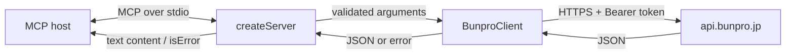

# Architecture

## Overview

Bunpro MCP is a local, read-only Model Context Protocol server. An MCP host starts the process over stdio, supplies a Bunpro bearer token through the environment, and invokes tools that query Bunpro's unofficial frontend API.

## Stack and runtime

- TypeScript targeting ES2022, emitted as ESM.
- Node.js 18 or newer, using built-in `fetch`, `URL`, and process APIs.
- Official `@modelcontextprotocol/sdk` server and stdio transport.
- Zod for MCP input schemas.
- esbuild for the executable bundle; TypeScript emits declarations.
- Node's test runner through `tsx` for TypeScript tests.

## Components

### `src/index.ts`

The executable entry point. It reads `BUNPRO_API_TOKEN` and optional `BUNPRO_API_BASE_URL`, creates the client and server, connects stdio transport, and closes on `SIGINT`. stdout belongs exclusively to MCP framing; startup failures use stderr.

### `src/server.ts`

The protocol adapter. `createServer` registers 21 read-only tools, defines Zod input schemas and annotations, delegates calls to `BunproClient`, and converts JSON or failures into MCP tool results.

### `src/client.ts`

The integration layer. `request` builds authenticated GET or POST requests and parses JSON. Specialized methods cover search, activity, quiz questions, and last-session accuracy.

### `test/`

- `client.test.ts`: request construction, authentication, errors, and search projection.
- `server.test.ts`: tool inventory and MCP-to-HTTP delegation through in-memory transport.
- `live-api.test.ts`: opt-in checks against read-only endpoints.

## Request flow

1. The MCP host sends a tool call over stdio.
2. The SDK applies the registered Zod schema.
3. The handler delegates to `BunproClient`.
4. The client sends an authenticated HTTPS request and parses the response.
5. The server serializes the value as JSON text. Expected upstream failures return `isError: true`.

Most outputs preserve Bunpro's upstream JSON. Search and last-session responses are local projections documented in [MCP contracts](MCP_CONTRACTS.md).

## Configuration

| Setting | Required | Purpose |
| --- | --- | --- |
| `BUNPRO_API_TOKEN` | Yes | Bearer token sent to the Bunpro frontend API. |
| `BUNPRO_API_BASE_URL` | No | Override of `https://api.bunpro.jp/api/frontend`, primarily for tests. |

The only runtime services are the MCP host and Bunpro. No database, cache, telemetry, resource handlers, prompt handlers, OAuth flow, or write operations are implemented.

## Architectural choices

- **Local stdio:** keeps the bearer token on the user's machine. A public hosted service needs a separate authentication and token-storage design.
- **One tool per action:** explicit schemas are easy for hosts to discover. Reassess if the API surface grows substantially beyond the current 21 tools.
- **Read-only scope:** every tool is annotated read-only and uses observed read endpoints.
- **Pass-through responses:** avoids duplicate Bunpro models, but most output shapes can change with the frontend API.
